# Smart Agent Query Router

A small service that takes a question like "show my open pull requests" and sends it to
the right agent. There are two mock agents, GitHubAgent and LinearAgent. If a question
isn't about either of them, the router replies with `I cannot answer this question.`

You can use it from the command line, through a FastAPI backend, or in a React web UI.

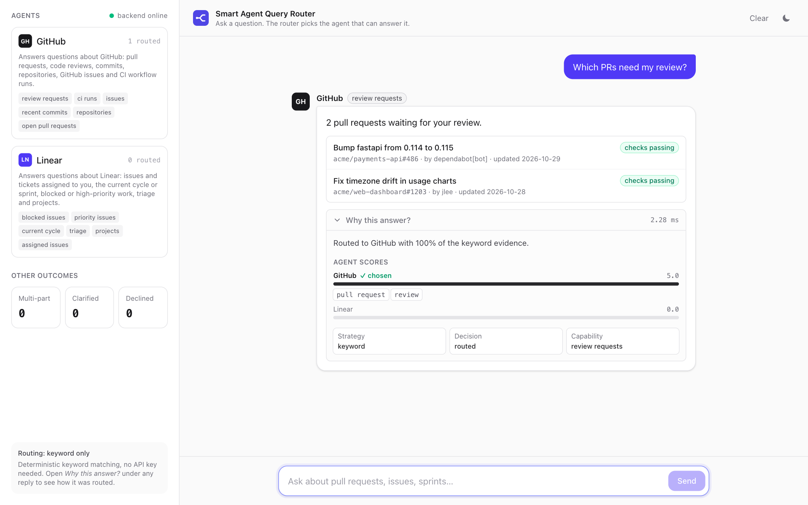

## Contents

1. [Requirements and what's done](#requirements-and-whats-done)
   - [Running the backend](#running-the-backend)
   - [API docs](#api-docs)
   - [CLI](#cli)
   - [Tests](#tests)
2. [Docker](#docker)
3. [Extra features](#extra-features)
4. [Frontend](#frontend)
5. [Commands](#commands)

## Requirements and what's done

The basic requirements were:

- Route a question to GitHubAgent or LinearAgent based on what it's asking
- "Show my open pull requests" should go to GitHubAgent
- "What issues are assigned to me?" should go to LinearAgent
- Anything else (like "What's the weather today?") should return exactly
  `I cannot answer this question.`
- A CLI or a small API
- Keep the routing logic separate from the agent logic
- Nice to have: unit tests, logging of routing decisions, an agent design that's easy
  to extend

All of these are done. There's both a CLI and an API. The routing code lives in
`backend/app/router/` and the agents live in `backend/app/agents/`. Agents don't import
anything from the router, and the router only talks to agents through a small interface
(`name`, `description`, `keywords`, `handle()`). The agents return mock data from JSON
files.

```text
> Show my open pull requests
[GitHubAgent] You have 3 open pull requests.

> What issues are assigned to me?
[LinearAgent] You have 4 open issues assigned to you.

> What's the weather today?
I cannot answer this question.
```

### Running the backend

You need Python 3.11 or newer.

```bash
cd backend
python3 -m venv .venv
source .venv/bin/activate
pip install -r requirements-dev.txt
uvicorn app.main:app --reload
```

The API runs on http://localhost:8000 and the docs are at http://localhost:8000/docs.

### API docs

There are three endpoints:

- `POST /api/query` takes `{"query": "..."}` and returns the answer plus how it was routed
- `GET /api/agents` lists the agents and what they can answer
- `GET /api/health` is a health check

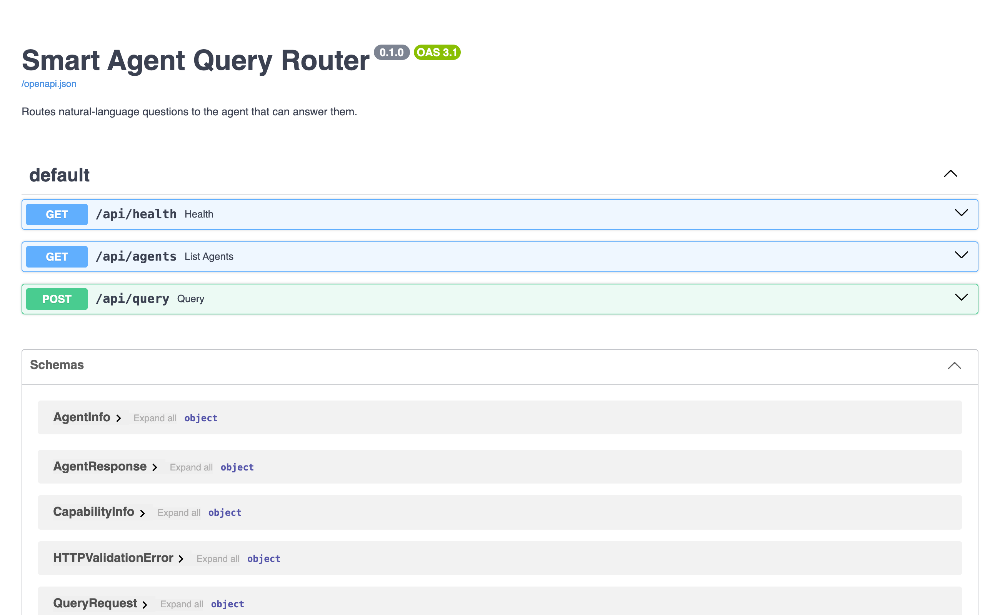

Here's a query that gets routed to GitHub. The response includes the score for each
agent and the keywords that matched.

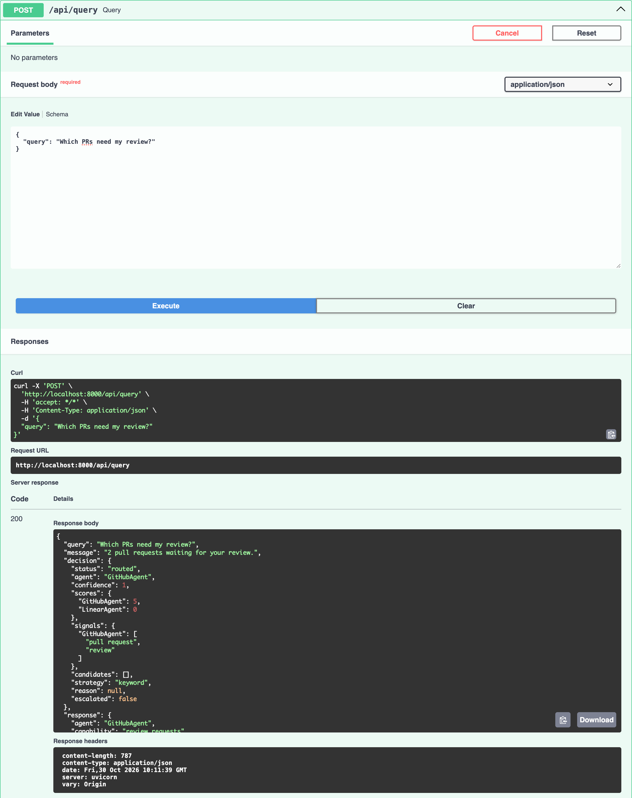

And an out-of-scope question, which gets the fallback message:

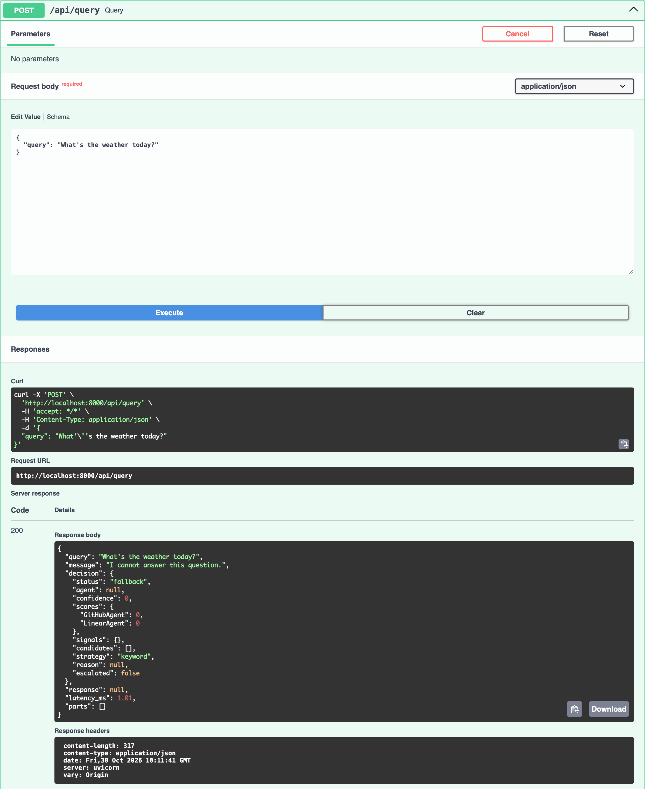

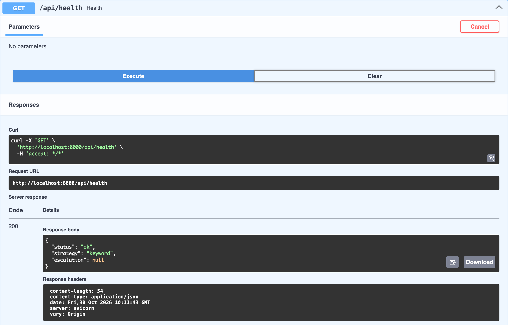

The `decision.status` field is `routed`, `clarify`, `fallback` or `multi` (more on the
last two below).

### CLI

```bash
cd backend
python -m app.cli                                       # interactive
python -m app.cli "Show my open pull requests"          # one question
python -m app.cli --trace "Which PRs need my review?"   # show how it was routed
```

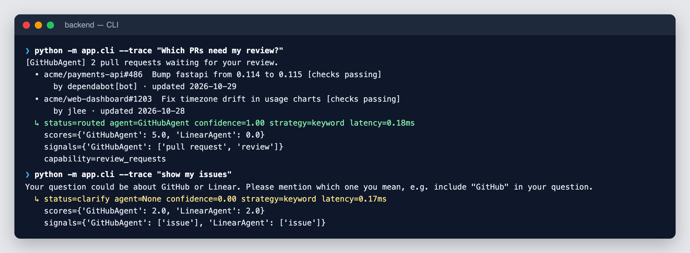

### Tests

```bash
cd backend
pytest -v
python -m eval.run
```

There are 57 tests covering the text cleanup, the agents, the routing rules, the API and
the optional LLM part (using a fake client, so no network calls).

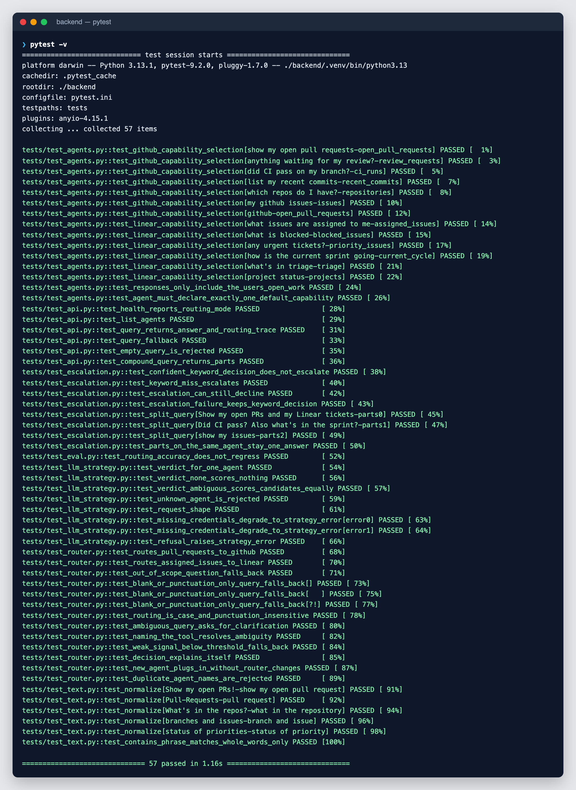

I also wrote a small set of 49 labelled questions in `eval/dataset.json` to check
accuracy. It currently gets 44 of them right (89.8%).

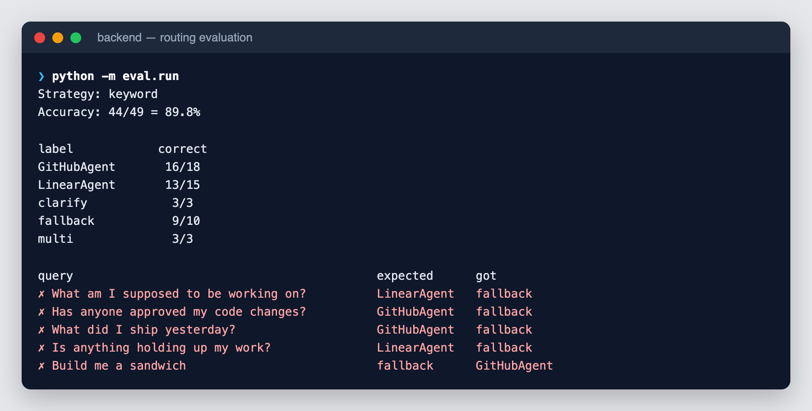

The 5 it misses are ones I added on purpose to see where keyword matching breaks.
Four of them are questions like "What am I supposed to be working on?" that don't use
any GitHub or Linear words, so the router declines instead of guessing. The other one is
"Build me a sandwich", which goes to GitHub because of the word "build". There's a test
that fails if accuracy drops below 85%, so I notice if a keyword change breaks things.

## Docker

To run the backend and the UI together:

```bash
docker compose up --build -d
docker compose ps
```

The UI is on http://localhost:3000 and the API on http://localhost:8000. The frontend
container waits until the backend's health check passes before it starts.

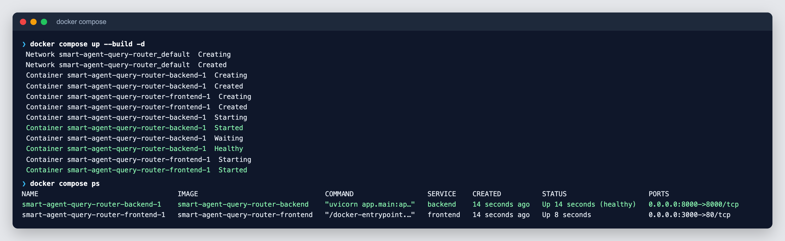

Calls to `localhost:3000/api` go through nginx to the backend:

```bash
curl -s localhost:3000/api/health
curl -s -X POST localhost:3000/api/query \
  -H "Content-Type: application/json" \
  -d '{"query":"Show my open pull requests"}'
```

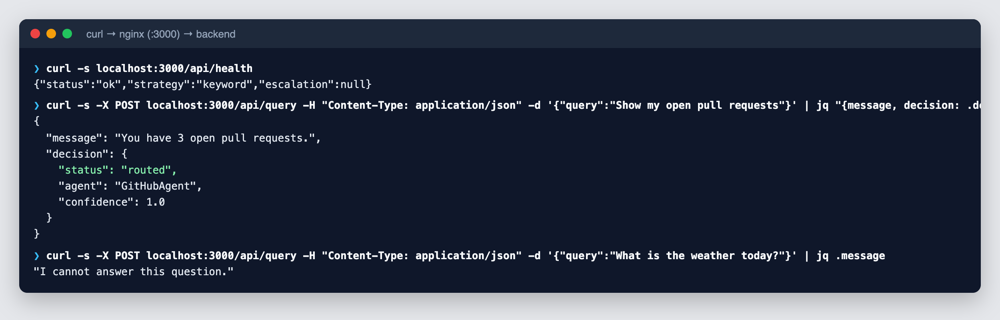

Every routing decision gets logged, so you can follow along with:

```bash
docker compose logs -f backend
```

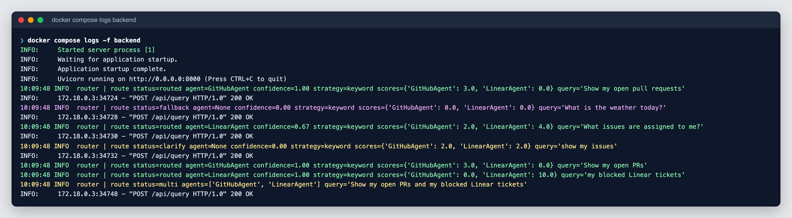

To stop everything, run `docker compose down`. Ports and settings can be changed by
copying `.env.example` to `.env`.

## Extra features

Some things I added beyond the requirements:

**Asking instead of guessing.** "Show my issues" could mean GitHub issues or Linear
issues. When both agents score about the same, the router asks which one you meant.

**Showing why.** Each response includes the scores and matched keywords, so you can see
why a question went where it did. In the CLI that's `--trace`, and in the UI it's the
"Why this answer?" section.

**Handling short forms.** "PRs", "repo" and "gh" get expanded before matching, and
plurals are stripped, so "PR" and "pull requests" match the same keywords.

**Questions with two parts.** "Show my open PRs and my blocked Linear tickets" is split
and each half goes to its own agent. It only splits when both halves make sense on their
own and go to different agents.

**Capabilities inside each agent.** After the router picks an agent, the agent picks
what to answer: review requests, CI runs, commits, the current sprint, blocked issues,
and so on.

**Optional Claude fallback.** If you set `ROUTER_STRATEGY=hybrid` and an
`ANTHROPIC_API_KEY`, questions the keyword router isn't sure about get sent to Claude.
Claude has to answer with one of the known agents, "none" or "ambiguous", and if the
call fails for any reason the router just keeps its keyword answer. It's off by default,
and I've only tested it with a fake client since I didn't have an API key.

```bash
pip install -r requirements-llm.txt
export ANTHROPIC_API_KEY=...
export ROUTER_STRATEGY=hybrid
python -m eval.run --strategy hybrid
```

### How the routing works

1. The question is lowercased, punctuation is removed, and short forms are expanded.
2. Each agent has a list of weighted keywords (for example `"github": 5`,
   `"pull request": 3`, `"issue": 2`). An agent's score is the total weight of its
   keywords found in the question.
3. If the best score is under 2, the router gives the fallback message. If the second
   best is at least 75% of the best, it asks for clarification. Otherwise it sends the
   question to the top agent.

For "What issues are assigned to me?", GitHub matches "issue" (2) and Linear matches
"issue" and "assigned" (4), so it goes to Linear.

### Adding an agent

Add one file to `backend/app/agents/` and it gets picked up automatically:

```python
from app.agents.base import BaseAgent, Reply, capability
from app.agents.registry import register_agent


@register_agent
class SlackAgent(BaseAgent):
    name = "SlackAgent"
    label = "Slack"
    description = "Answers questions about Slack messages and channels."
    keywords = {"slack": 5, "channel": 3, "dm": 3, "mention": 2}

    @capability("mentions", "Messages that mention you", keywords=("mention",), default=True)
    def mentions(self, query: str) -> Reply:
        return "You have 2 unread mentions.", []
```

### Project structure

```text
backend/
  app/
    agents/       GitHubAgent, LinearAgent, base class, registry, mock data
    router/       QueryRouter, keyword and LLM scoring, question splitter
    api/          FastAPI routes
    cli.py
    models.py
  eval/           labelled questions and accuracy script
  tests/
frontend/
  src/            React app and components
docker-compose.yml
.github/workflows/ci.yml   runs tests, eval, lint and build on each push
```

### Assumptions and limitations

- All data is mocked, and "you" in the data means the current user.
- Questions are assumed to be in English.
- "Issues" on its own is treated as ambiguous since both tools have issues.
- Keyword matching misses questions that don't use any related words. The Claude
  option is meant to help with those.
- There's no conversation memory, so answering a clarification means asking again
  (the buttons in the UI do this for you).
- There are no real GitHub or Linear API calls. The agents could be pointed at real APIs
  later without changing the router.

## Frontend

Built with React, TypeScript, Tailwind and Vite. With the backend running:

```bash
cd frontend
npm install
npm run dev
```

It opens on http://localhost:5173 and forwards `/api` requests to the backend.

The home screen lists the agents on the left with what each one can answer, and has a
few example questions to try.

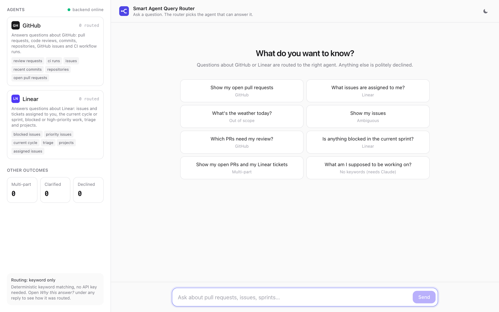

A routed answer, with "Why this answer?" opened:


A Linear question:

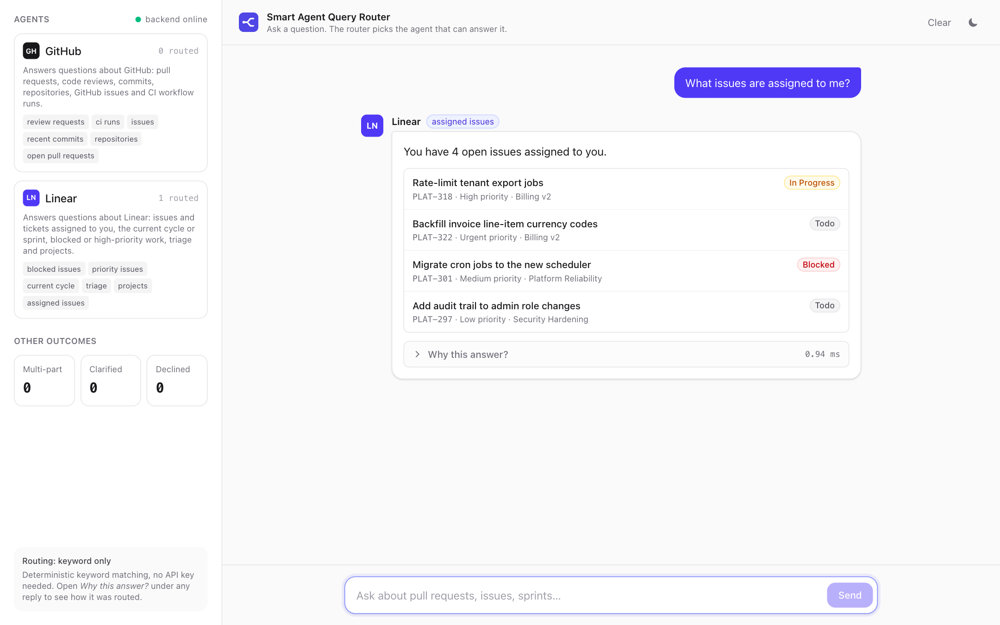

When a question is ambiguous you get a button for each tool:

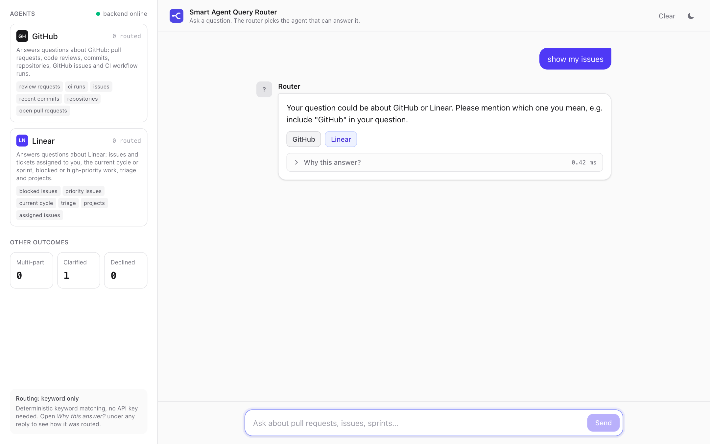

Clicking "Linear" asks the question again with Linear in it:

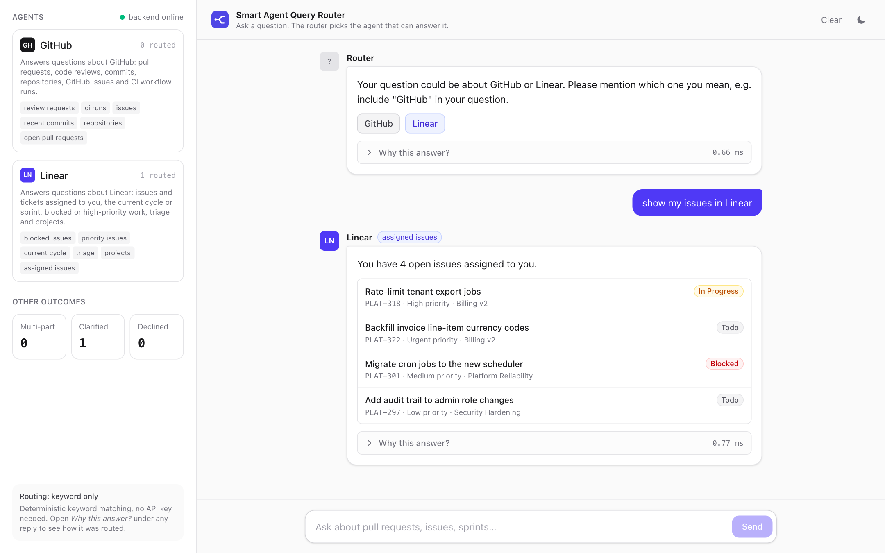

An out-of-scope question:

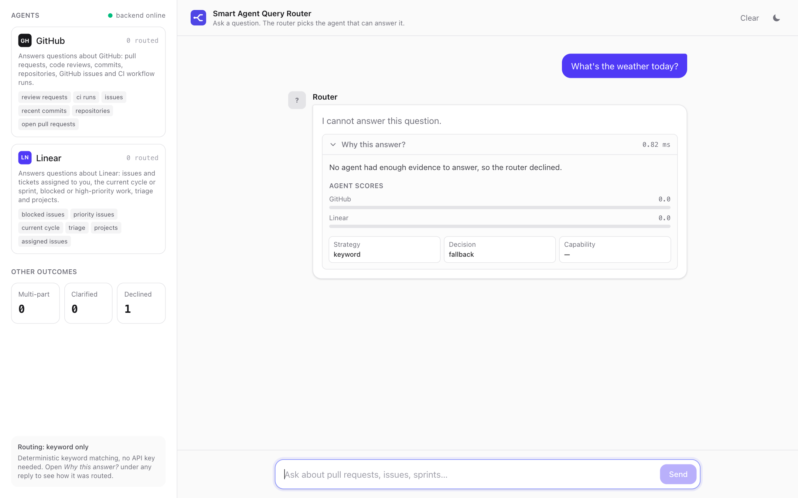

A question with two parts:

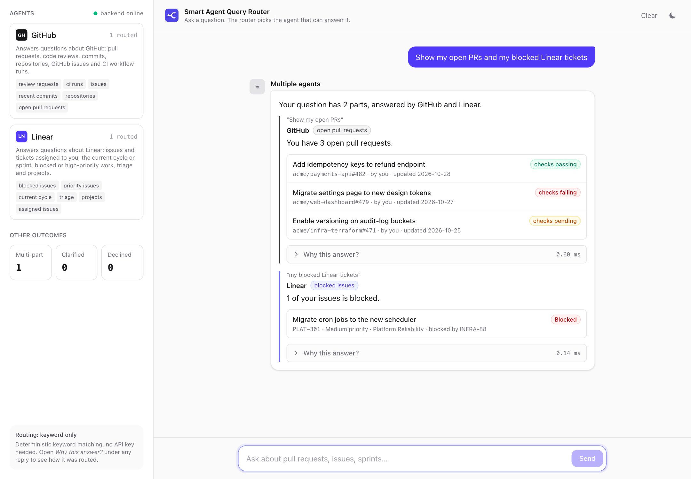

There's also a dark mode:

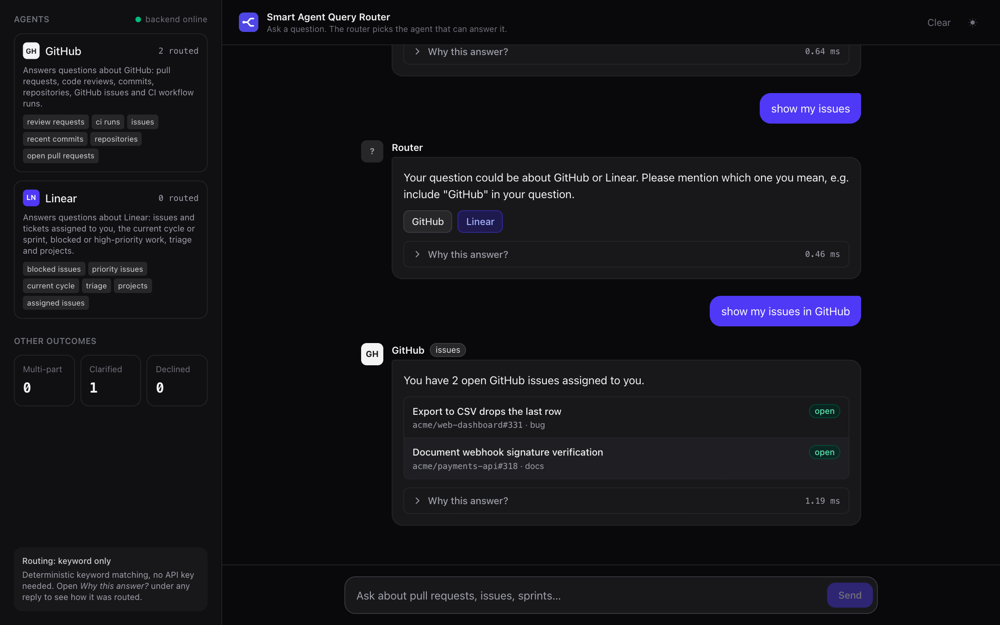

## Commands

Backend (from `backend/`):

```bash
pip install -r requirements-dev.txt     # install
uvicorn app.main:app --reload           # run the API
python -m app.cli                       # run the CLI
pytest -v                               # tests
python -m eval.run                      # accuracy report
python -m eval.run --all                # show every question, not just misses
```

Frontend (from `frontend/`):

```bash
npm install
npm run dev
npm run build
npm run lint
```

Docker (from the project root):

```bash
docker compose up --build -d
docker compose logs -f backend
docker compose down
```
